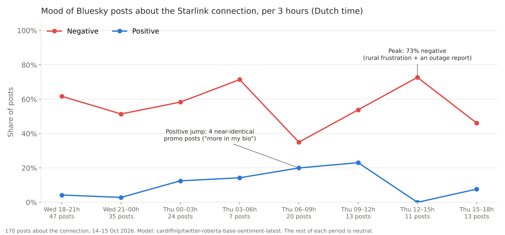
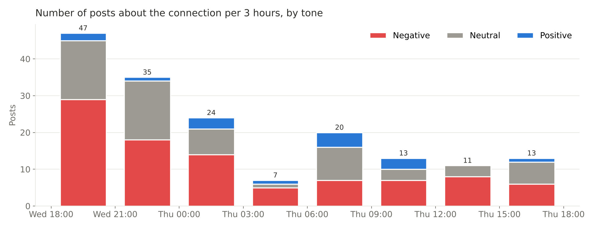
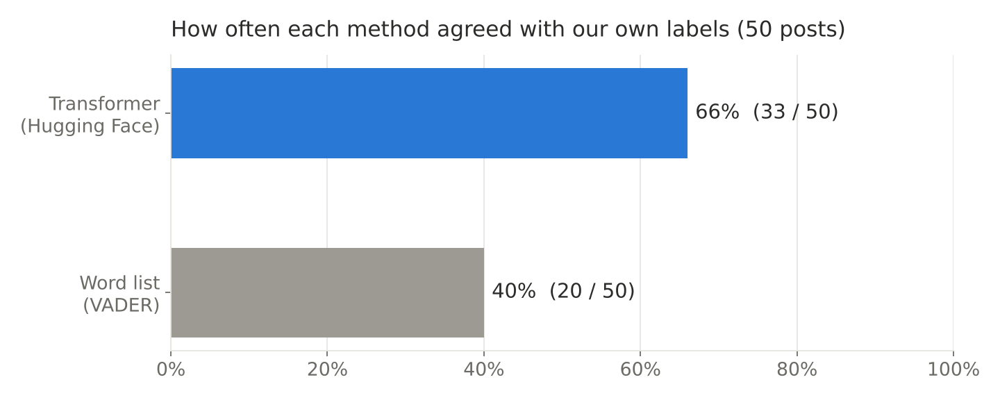

# Starlink Pulse

**Project:** Starlink Pulse: a live sentiment tracker for satellite-internet experience  
**Hackathon:** AI for Good, Hackathon 6 "Live Pulse"  
**SDG:** 9 (Industry, Innovation and Infrastructure), target 9.c  
**Primary user:** A rural municipality's digital-inclusion or broadband officer preparing a recommendation about a Starlink pilot or subsidy for households without a practical fibre or mobile-broadband alternative.  
**Data stream:** Public English-language Bluesky posts that mention Starlink, collected every 30 minutes and filtered to posts about the connection experience.  
**AI method:** A pre-trained Hugging Face sentiment transformer (`cardiffnlp/twitter-roberta-base-sentiment-latest`) run by our own code, compared with a simple word-list baseline (VADER).

## Links

| What | Link |
|---|---|
| Live dashboard | [starlink-pulse.streamlit.app](https://starlink-pulse.streamlit.app) |
| Collector (fetch, analyse, store) | [collector.py](https://github.com/cameronruiter/starlink-pulse/blob/main/collector.py) |
| Topic filter ("about the connection") | [scope.py](https://github.com/cameronruiter/starlink-pulse/blob/main/scope.py) |
| Dashboard code | [app.py](https://github.com/cameronruiter/starlink-pulse/blob/main/app.py) |
| Schedule (runs the collector every 30 min) | [.github/workflows/collect.yml](https://github.com/cameronruiter/starlink-pulse/blob/main/.github/workflows/collect.yml) |
| Collected data (text, time, sentiment) | [data/posts.csv](https://github.com/cameronruiter/starlink-pulse/blob/main/data/posts.csv) |
| Honest test: results | [test/results.md](https://github.com/cameronruiter/starlink-pulse/blob/main/test/results.md) |
| Honest test: full table (50 posts, our label, both models) | [test/test_table.csv](https://github.com/cameronruiter/starlink-pulse/blob/main/test/test_table.csv) |
| Honest test: our 50 labels | [test/label_sheet.csv](https://github.com/cameronruiter/starlink-pulse/blob/main/test/label_sheet.csv) |
| Test script | [evaluate.py](https://github.com/cameronruiter/starlink-pulse/blob/main/evaluate.py) |
| Sentiment model card | [Hugging Face: cardiffnlp/twitter-roberta-base-sentiment-latest](https://huggingface.co/cardiffnlp/twitter-roberta-base-sentiment-latest) |
| Word-list baseline | [VADER on GitHub](https://github.com/cjhutto/vaderSentiment) |

## What Starlink Pulse does

Starlink Pulse is a monitoring aid for a rural municipality considering whether to recommend or subsidise Starlink for households with few other connectivity options. Every 30 minutes it fetches new public Bluesky posts that mention Starlink, classifies the tone of each post with a pre-trained transformer, stores the result with a timestamp, and shows how the share of negative and positive posts changes over time. The user can open any period on the chart and read the posts behind a rise or dip.

The intended benefit is earlier awareness of recurring, user-reported problems that may deserve local follow-up. The dashboard measures sentiment in a specific online discussion. It does not measure network uptime, outage duration, speed, service quality for all customers, or public opinion in the municipality.

## Why this matters

In 2023, internet access was reported by 90.5% of EU rural households, compared with 94.9% of city households. This is a 4.4 percentage-point difference in household internet access; it is not a measure of broadband speed or reliability. [Eurostat: Urban-rural Europe — digital society](https://ec.europa.eu/eurostat/statistics-explained/index.php?title=Urban-rural_Europe_-_digital_society)

The European Commission's 2024 broadband-coverage study reports availability across 31 countries and for rural areas, including satellite technology. Coverage statistics describe whether networks are available; they do not tell a municipality whether people's day-to-day connections are dependable. [European Commission: Digital Decade 2025 — Broadband Coverage in Europe 2024](https://digital-strategy.ec.europa.eu/en/library/digital-decade-2025-broadband-coverage-europe-2024)

Together, these sources establish a rural-connectivity context, not proof that Starlink is unreliable or that online complaints represent rural residents. Starlink Pulse tests whether an online discussion can provide a useful qualitative signal to investigate alongside local evidence.

### SDG 9 link

SDG 9 target 9.c asks countries to *"significantly increase access to information and communications technology and strive to provide universal and affordable access to the Internet"*, and target 9.1 asks for *"quality, reliable, sustainable and resilient infrastructure… with a focus on affordable and equitable access for all"* ([UN: Goal 9](https://sdgs.un.org/goals/goal9)). Satellite internet is new infrastructure that many rural areas now depend on. Starlink Pulse helps a public body check whether that infrastructure is experienced as reliable before it spends public money on it.

## Problem and user brief

### Problem

A rural municipality deciding whether to recommend or subsidise Starlink for households with few alternatives needs evidence about the experience residents may have after adoption, not just an availability claim. Conventional coverage statistics describe where infrastructure is available, but not the reasons behind each user's day-to-day experience. Meanwhile, the municipality cannot manually read every new public post about connection problems: our stream alone produced about 5,800 Starlink posts in under a day.

Starlink Pulse tests whether a continuously collected public discussion can help the municipal broadband officer notice patterns in **reported experience** and decide what to investigate next. It does not establish the true frequency or duration of outages. A sentiment tracker can direct attention, but service reliability requires independent evidence such as network measurements, provider incident records or structured resident research.

### User context

The user is a municipal broadband or digital-inclusion officer preparing a briefing for councillors. They need a readable trend, a clear count of items behind it, and example posts that explain what changed. They have limited time and cannot manually monitor a large stream. Their decision has public consequences: a subsidy may help households who lack alternatives, but it also uses public funds and may set expectations about performance.

### Who is missing or underrepresented

The stream excludes or underrepresents people who do not use Bluesky, do not post publicly, do not write in English, have limited digital access, avoid public complaints, or do not name Starlink in their post. People without a working connection cannot post at all, so the worst outages may be under-counted. People satisfied with the service may post less often than people facing an issue, and one highly active account or a viral post may dominate a period. The chart must never be described as "what rural residents think."

## Data stream and its terms

**Source:** Bluesky's public search API (`app.bsky.feed.searchPosts`), query `starlink`, language `en`, read with a free Bluesky account and an app password stored as a GitHub secret.

**Why not Reddit:** We first planned to use r/Starlink. Reddit's [Responsible Builder Policy](https://support.reddithelp.com/hc/en-us/articles/42728983564564-Responsible-Builder-Policy) states: *"You must request access and get explicit approval before accessing any Reddit data through our API."* Approval was not possible within the deadline, and scraping Reddit without approval would break its terms, so we switched to Bluesky, whose public API is open to any account holder.

**Terms we follow:** Bluesky's [Terms of Service](https://bsky.social/about/support/tos) and [Developer Guidelines](https://bsky.network/docs/developer-guidelines/). We only read public posts, search at most once every 30 minutes (normally a few pages of 100 posts per run), and never post, like or follow.

**What we store** (and nothing else): a short hash of the post address (only to avoid duplicates), the time it was posted and collected, whether it was collected live or in the catch-up run, the post text with links removed and @mentions replaced by `@user`, and the model's label and scores. We do **not** store names, handles, profile information or post links.

**Known gap:** Bluesky's Developer Guidelines say services must have a way to delete content a user asks to have deleted. Our tool does not yet re-check whether a stored post was later deleted by its author. Because we store no author or link, a stored post cannot be traced back through our data, but a production version should re-check deletions and remove those posts.

## Solution: stream → fetch → model → storage → view

| Step | What happens | Where |
|---|---|---|
| **Schedule** | GitHub Actions starts the collector every 30 minutes (and on demand) | `.github/workflows/collect.yml` |
| **Fetch** | Logs in to Bluesky, pages back through the newest English posts containing "starlink" until it reaches posts it already has | `collector.py` |
| **Clean** | Removes links, replaces @mentions with `@user`, skips near-empty posts | `collector.py` |
| **Model** | Runs every post through `cardiffnlp/twitter-roberta-base-sentiment-latest` and stores the negative / neutral / positive probabilities and the winning label | `collector.py` |
| **Filter** | Marks a post as "about the connection" when it mentions the connection experience (internet, outage, speed, dish, rural, service …) **and** does not mention politics, war or space news | `scope.py` |
| **Store** | Appends new rows to `data/posts.csv` and commits it to this repository | `collect.yml` |
| **View** | Streamlit dashboard reads the CSV from GitHub every 5 minutes: share of negative and positive posts per hour / 3 h / 6 h / day, number of posts per period, an "unusual rise" marker, and a table of the posts behind any period | `app.py` |

### Why we tightened the topic filter

Our first filter only checked for connection words. After reading the first day of data, we found that **86% of the posts it kept (925 of 1,071) were really about politics, war or space news** (Ukraine, Elon Musk, US politics, rocket launches), for example posts about "Starlink access for the Ukrainian army". We added a list of off-topic words (`OFF_TOPIC_WORDS` in `scope.py`). That left 155 posts that are actually about people's internet, such as *"I need stable service at my remote cottage to monitor the thermostat & sump pump"*. The filter is still a word list, so it is not perfect in either direction (see the honest test).

## Model card summary

| | `cardiffnlp/twitter-roberta-base-sentiment-latest` |
|---|---|
| **Type** | RoBERTa-base transformer, fine-tuned for sentiment |
| **Trained on** | ~124 million tweets from January 2018 to December 2021, then fine-tuned on the TweetEval sentiment benchmark |
| **Language** | English |
| **Labels** | Negative, Neutral, Positive |
| **Licence** | CC BY 4.0 |
| **Paper** | Loureiro et al. (2022), *TimeLMs: Diachronic Language Models from Twitter*, ACL 2022 System Demonstrations |
| **Source** | [Hugging Face model card](https://huggingface.co/cardiffnlp/twitter-roberta-base-sentiment-latest) |

**Why we chose it:** Bluesky posts are short, informal social-media posts, which is exactly the kind of text this model was trained on (tweets). It gives a separate neutral label, which matters because many Starlink posts are questions or news. It is free to run on a normal CPU, so it works inside GitHub Actions without a paid API. Its weakness for us: it is English-only and was trained on tweets up to 2021, so newer slang and Starlink-specific jargon ("dishy", "obstructions") may be misread.

**Baseline:** [VADER](https://github.com/cjhutto/vaderSentiment) (Hutto & Gilbert, 2014; MIT licence), a rule-based word-list tool designed for social media. It scores each word from a fixed list and adds them up; it does not learn or read context.

## Data collected

<!-- Numbers as of 15 Oct 2026, 17:43 Dutch time. Update with the dashboard's "How this works" box before submitting. -->



| | |
|---|---|
| Posts collected and analysed | 6,542 (as of 15 Oct 2026, 17:43 Dutch time) |
| Of which "about the connection" | 170 |
| Period covered by the posts | 14 Oct 2026 18:27 → 15 Oct 2026 17:42 (Dutch time) |
| Collected live by the running tool | 1,012 (in 4 runs) |
| Collected by the one-off catch-up run | 5,530 |
| Tone of posts about the connection | 55% negative · 36% neutral · 9% positive |
| Tone of all Starlink posts | 58% negative · 40% neutral · 2% positive |



### Behind a peak and a dip

**Peak: Thursday 12:00–15:00, 73% negative (8 of 11 posts).** Opening this period on the dashboard shows real rural frustration rather than one big outage: *"Starlink is used primarily in rural areas like where I live in West Scotland because other companies left us all high and dry"*, a complaint about a mobile provider's planned Starlink deal, and one genuine outage report: *"Starlink was offline so I couldn't download my ticket."* Two of the 11 posts were off-topic (an arson attack on a ground station, and a politics newsletter) that slipped through our filter. For the broadband officer, this period is a reason to look at rural dependency, not proof of an outage.

**Dip in negativity: Thursday 06:00–09:00, only 35% negative and 20% positive.** The jump in "positive" came from **four near-identical promotional posts** (*"Starlink plays an important role in connectivity… More context via my bio"*), posted within two minutes, probably by one account or a bot. Without them, this period would look like the others. This is exactly the risk the brief warns about: one active account can move the line. It is why the dashboard shows the number of posts behind every point and lets the user read them.

**Honest note on the 48-hour requirement:** the tool first ran on 15 October. To have more than a few hours of data, its first run caught up on older posts: it reached back to 14 October 18:27 (Dutch time) before hitting its safety limit of 6,000 posts. Every post keeps its real posting time, and the dashboard can show live-collected posts only (switch off "Include the catch-up run").

**Honest note on the 30-minute schedule:** the workflow is set to run every 30 minutes (`cron: "*/30 * * * *"` in [collect.yml](https://github.com/cameronruiter/starlink-pulse/blob/main/.github/workflows/collect.yml)). GitHub describes scheduled runs as best effort: they can be delayed or skipped when its servers are busy. On our new repository, GitHub had not started a single scheduled run several hours after the schedule was added, while every run we started from the Actions tab worked (see the run history under [Actions](https://github.com/cameronruiter/starlink-pulse/actions)). So during the hackathon, part of the live data was collected by starting the same workflow by hand. Each run picks up all posts since the previous one (up to 6,000 posts, about a day of Starlink posts, and at most 24 hours back), so no posts are missed between runs. The reliable fix is an external trigger that calls GitHub's workflow-dispatch API every 30 minutes (for example cron-job.org with a token that may only start this workflow).

## Honest test

We labelled **50 randomly chosen posts** from our own stream ourselves (negative / neutral / positive) *before* looking at any model output, then compared both methods with our labels. Full table: [test/test_table.csv](https://github.com/cameronruiter/starlink-pulse/blob/main/test/test_table.csv).

| Method | Agrees with our labels |
|---|---|
| **Transformer** (`twitter-roberta-base-sentiment-latest`) | **66%** (33 / 50) |
| **Word-list baseline** (VADER) | **40%** (20 / 50) |



**Where the transformer goes wrong** (rows = our label, columns = model):

| | negative | neutral | positive |
|---|---|---|---|
| **negative** (26) | 19 | 7 | 0 |
| **neutral** (18) | 6 | 10 | 2 |
| **positive** (6) | 1 | 1 | 4 |

Its mistakes are almost all between *negative* and *neutral*. It never called one of our negative posts positive. VADER called 9 of our 26 negative posts positive, because it reacts to single words like "love" or "connection".

### Failures that taught us the most

1. **Joke with a rude word.** *"I live in cottage country and internet here is piss poor. There are 10 cottages in here and 9 of them have starlink attached to their roof. Guess which roof doesn't have starlink."* We: neutral. Model: negative (87% sure). The model reacted strongly to "piss poor", but the writer is making a wry joke rather than complaining about Starlink.
2. **A question that sounds negative.** *"Are starlink speeds actually measured in km/h? That's a pretty weird unit for measuring the speed of digital communications."* We: neutral. Model: negative. It is a genuine question, but "weird" pushed the model towards negative.
3. **Negativity without negative words.** *"Time for all former US allies to move away from US internet infrastructures, starting with Starlink."* We: negative. Model: neutral (VADER also neutral). The post is a call to boycott, but none of its words are negative on their own, so both methods missed it.
4. **Our own filter leaked.** Several sampled posts were still about the war in Ukraine (*"putler"*, *"Moscow escalates"*, *"interceptors"*) because those exact words were not on our off-topic list. A word filter is never complete.

### Which one would we hand to our user?

**The transformer.** It agreed with us far more often (66% vs 40%) and never mistook a complaint for praise, which is the mistake that would hurt a broadband officer most. But 66% is not reliable enough to act on alone: about one in three posts is labelled differently from how we read it. That is why the dashboard always shows the number of posts behind each point, and why the officer must open and read the posts behind a peak before drawing any conclusion.

## Ethical reflection

> Starlink Pulse reads public Bluesky posts, but those posts do not represent every household, and people without reliable internet may be least able to contribute: someone whose connection is down cannot post about it. A rise in negative sentiment could come from a viral post or a few frequent posters rather than a widespread service problem; a quiet chart could mean that people are not posting, not that service is reliable. On Bluesky, most talk about Starlink is political (86% of our first "connection" posts were about Ukraine, Musk or US politics), so without our topic filter the chart would have shown anger at a company owner, not experience of a connection. The English-language transformer misreads jokes, questions and implied criticism (it agreed with our own labels only 66% of the time), and it was trained on tweets rather than posts about satellite internet. If councillors treat the chart as an outage measurement or a representative survey, they could make a poor subsidy decision. What we did about it: we store no names, handles, profiles or post links; we show the number of posts next to every score and fade periods with fewer than five posts; we added a visible warning on the dashboard that the chart is not an outage measurement or public opinion; we let the user read every post behind a change; and we tightened the topic filter after reading our own data. Remaining risk: our tool does not yet remove posts that authors later delete, which Bluesky's developer guidelines require for services.

## How to run

**Collector (runs by itself):**

1. Create a free Bluesky account and an app password (Settings → Privacy and security → App passwords).
2. In this repository: Settings → Secrets and variables → Actions → add `BSKY_HANDLE` and `BSKY_APP_PASSWORD`.
3. Settings → Actions → General → Workflow permissions → **Read and write**.
4. Actions → **Collect Starlink posts** → Run workflow. Use `backfill_hours = 48` once for the first run, `0` afterwards. After that, it runs every 30 minutes.

Run it on your own computer instead:
```
pip install torch transformers requests pandas
set BSKY_HANDLE=yourname.bsky.social          (Mac/Linux: export ...)
set BSKY_APP_PASSWORD=xxxx-xxxx-xxxx-xxxx
python collector.py
```

**Dashboard:** deploy this repository on [share.streamlit.io](https://share.streamlit.io) with main file `app.py`, or run it locally:
```
pip install -r requirements.txt
streamlit run app.py
```

**Honest test:** `python evaluate.py sample` picks 50 posts into `test/label_sheet.csv`. Fill in `my_label` yourself, then `python evaluate.py score` writes `test/test_table.csv` and `test/results.md`. Both steps can also be started from Actions → **Honest test**.

## What it must not be used for

- **Not** as a measurement of outages, speed or uptime. It measures the tone of posts.
- **Not** as a survey of what residents or Starlink users think.
- **Not** as the only evidence for a subsidy or procurement decision; always verify with network data, provider records or local research.
- **Not** to identify, follow or judge individual people who post.
- **Not** as marketing for or against SpaceX/Starlink.

## Sources

- Eurostat. *Urban-rural Europe — digital society.* [Link](https://ec.europa.eu/eurostat/statistics-explained/index.php?title=Urban-rural_Europe_-_digital_society)
- European Commission (2025). *Digital Decade 2025: Broadband Coverage in Europe 2024.* [Link](https://digital-strategy.ec.europa.eu/en/library/digital-decade-2025-broadband-coverage-europe-2024)
- United Nations. *Goal 9: Industry, Innovation and Infrastructure.* [Link](https://sdgs.un.org/goals/goal9)
- Loureiro, D., Barbieri, F., Neves, L., Espinosa Anke, L., & Camacho-Collados, J. (2022). *TimeLMs: Diachronic Language Models from Twitter.* ACL 2022 System Demonstrations. [Model card](https://huggingface.co/cardiffnlp/twitter-roberta-base-sentiment-latest)
- Hutto, C.J. & Gilbert, E. (2014). *VADER: A Parsimonious Rule-based Model for Sentiment Analysis of Social Media Text.* ICWSM-14. [GitHub](https://github.com/cjhutto/vaderSentiment)
- Reddit. *Responsible Builder Policy.* [Link](https://support.reddithelp.com/hc/en-us/articles/42728983564564-Responsible-Builder-Policy)
- Bluesky. *Terms of Service* ([link](https://bsky.social/about/support/tos)) and *Developer Guidelines* ([link](https://bsky.network/docs/developer-guidelines/)).
